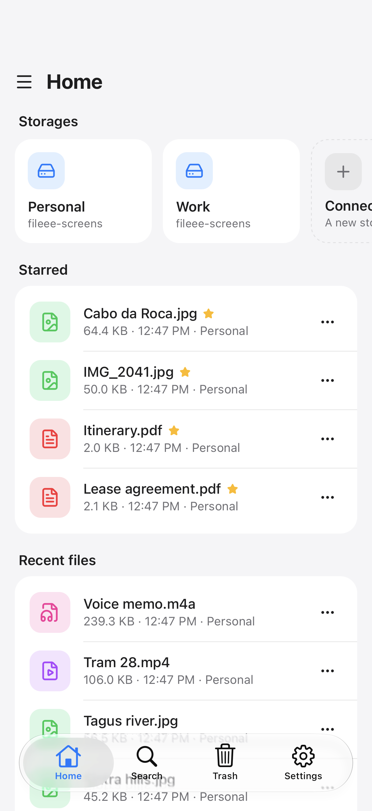
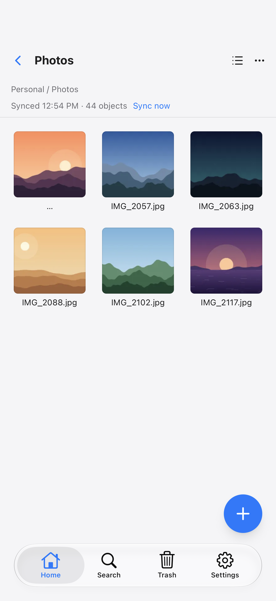
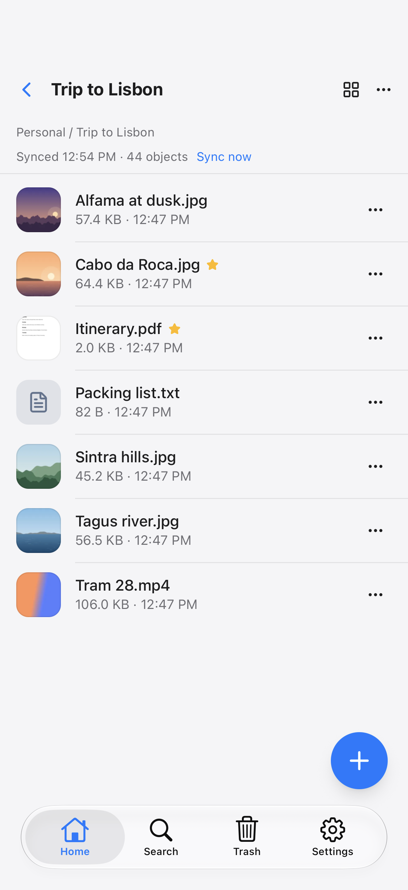
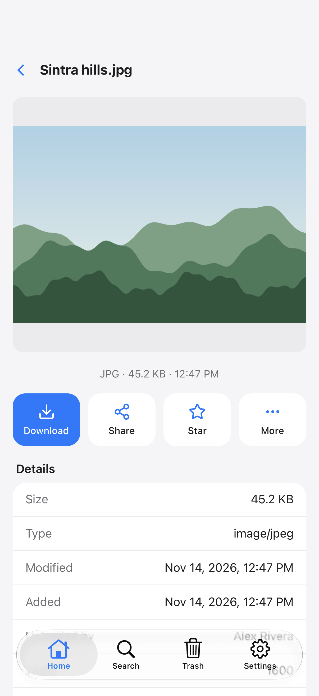
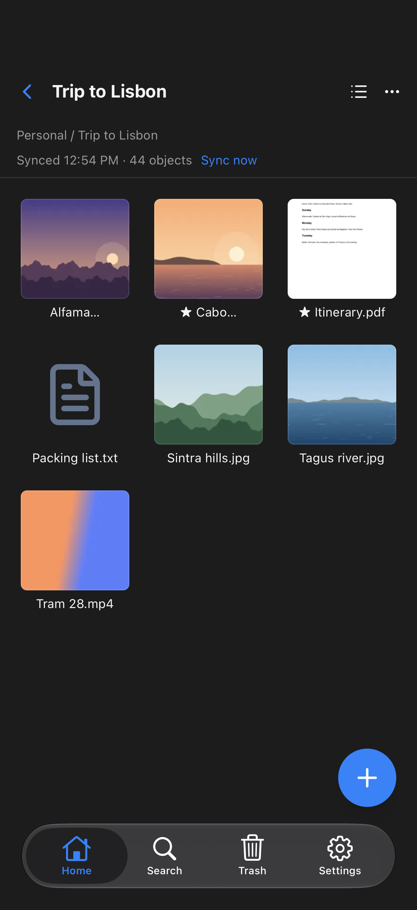
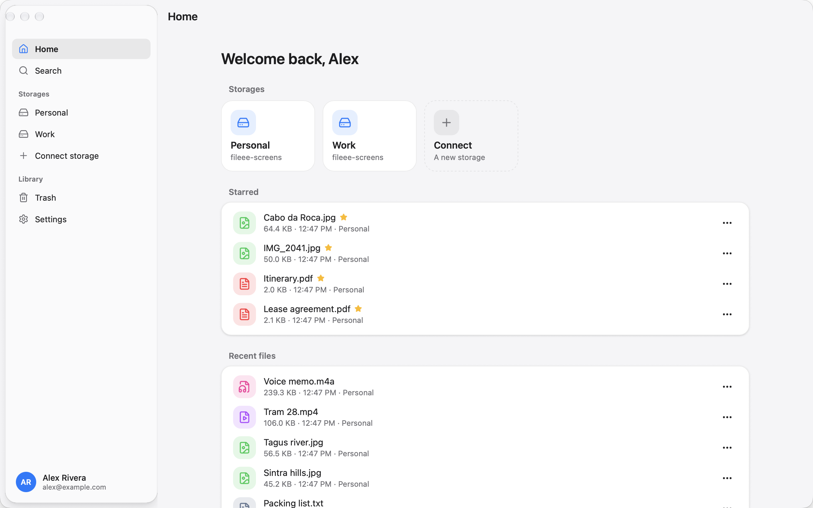
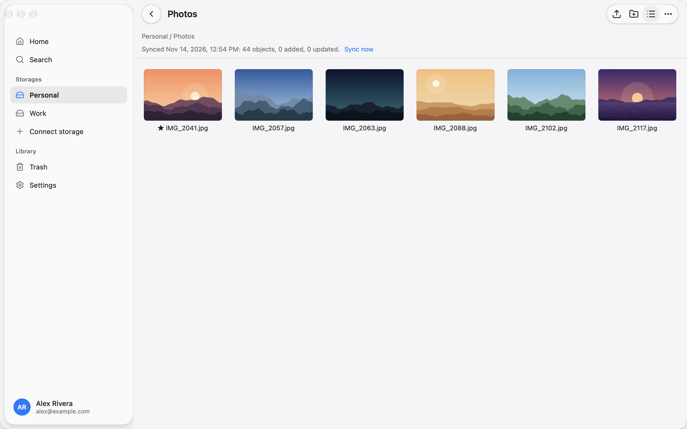
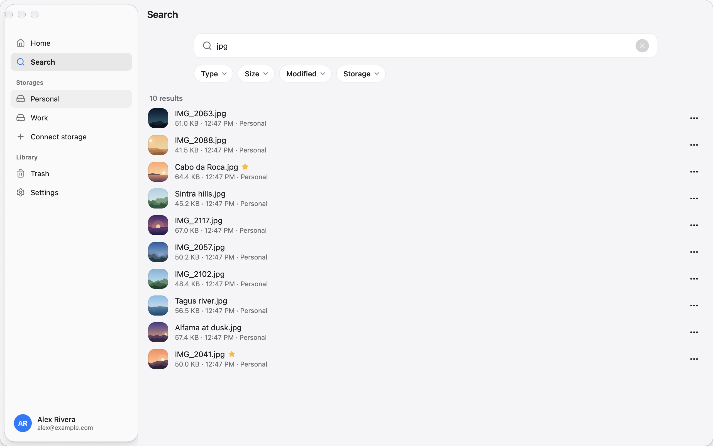
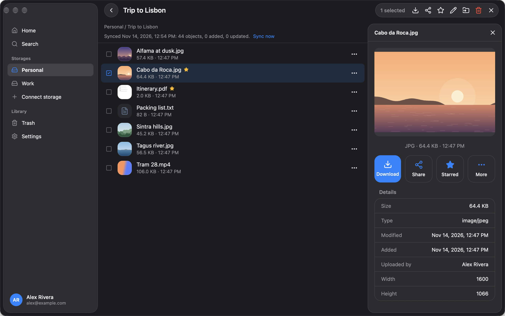

# Fileee app

The desktop and mobile app for [Fileee](https://github.com/fileee-app/web), built with [NSH](https://nsh.dev/docs/): TSX for the UI and a small Rust crate for what needs native code. One codebase runs on macOS, Windows, Linux, iOS and Android.

You connect it to your own Fileee server: enter its address, set it up if it's new, and sign in. You get what the web app has: storages, folders and files, previews, uploads (files, folders and photos), search with filters, sharing and public copies, trash, and settings for your account, storages and users. It talks to the server's app API (`/api/app`), documented in the web repo's docs under **Reference › App API**.

Desktops get a sidebar, a menu bar with shortcuts, right-click menus, file and folder dialogs, drag and drop, and the web app's keyboard shortcuts (⌘A, Enter, F2, M, S, Delete, Esc). Phones get the system tab bar, native headers, action sheets and long press to select.

## Screenshots

<p>
  
  
  
  
  
</p>

<p>
  
  
  
  
</p>

## Develop

You need the `nsh` CLI 0.5 (`brew install longbridge/tap/nsh`, or see [Installation](https://nsh.dev/docs/installation)) and Rust (`rustup`). The crate's `nsh-core` and `nsh-base` versions in `native/Cargo.toml` must match the CLI's. From the `app/` folder:

```bash
nsh run                    # desktop window; TSX reloads on save, Rust edits rebuild
nsh check                  # type check (TSX and the crate)
nsh test                   # headless tests, network stubbed
```

To try it against a local server, run the web repo's `pnpm dev` and connect to `http://localhost:3000`.

Each platform builds the Rust crate with its own tools:

- **iOS**: Xcode selected as the developer directory (`sudo xcode-select -s /Applications/Xcode.app`), a simulator runtime, and `rustup target add aarch64-apple-ios aarch64-apple-ios-sim`. Then `nsh run --target ios`.
- **Android**: the Android SDK with an NDK (`sdkmanager "ndk;<version>"`), `ANDROID_HOME` set, `rustup target add aarch64-linux-android armv7-linux-androideabi x86_64-linux-android`, and a device or emulator in `adb devices`. Then `nsh run --target android`. To reach a server on your computer's `localhost`, run `adb reverse tcp:3000 tcp:3000`.
- **Windows** and **Linux**: build on that system (`nsh run`); the crate's dependencies don't cross-compile from macOS.

## Layout

`app/` is the NSH app: everything it imports ships with it, so it all lives under that folder.

- `app/App.tsx`: the entry. Connect, set up or sign in, then the dashboard.
- `app/lib/`: the API client and session (`api.ts`), navigation, uploads, previews (`process.ts`) and shared actions.
- `app/components/`: the app's UI pieces. NSH's `nsh/base` gives behavior only; the look lives here.
- `app/screens/`: one file per page of the navigation stack.
- `app/assets/`: icons. `app/test-fixtures/`: files the tests drop in.
- `native/`: the Rust crate (`nsh.json` `"rust"`), the native module `fileee/native`: file and folder dialogs, reading local files in parts, image thumbnails and EXIF, SHA-256.
- `app/components/thumbnailer-host.tsx`: a hidden web view of the server's `/thumbnailer` page, which decodes PDFs and video with the browser engine's decoders.

## Known limits

- The session token is kept in NSH's `Storage`, a plain file in the app's data folder, not the system keychain.
- Phones upload from the photo picker; other files come from a computer.
- Thumbnails of PDFs and video, and HEIC or AVIF photos, are made by the web app's `/thumbnailer` page in a hidden web view, so they need the server to be this version or newer, and the bucket's CORS rule (**Apply CORS rule** in the storage's settings), as the web app does.
- PDF previews don't show on Android; download them instead.
